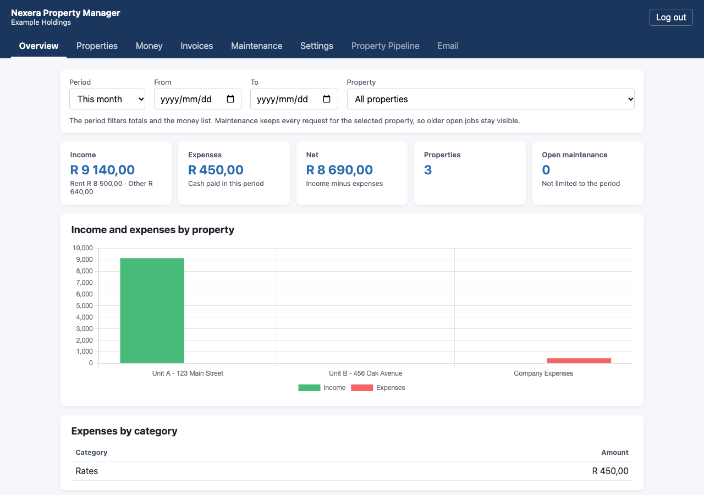
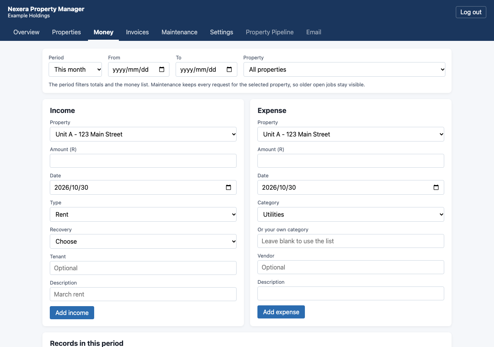
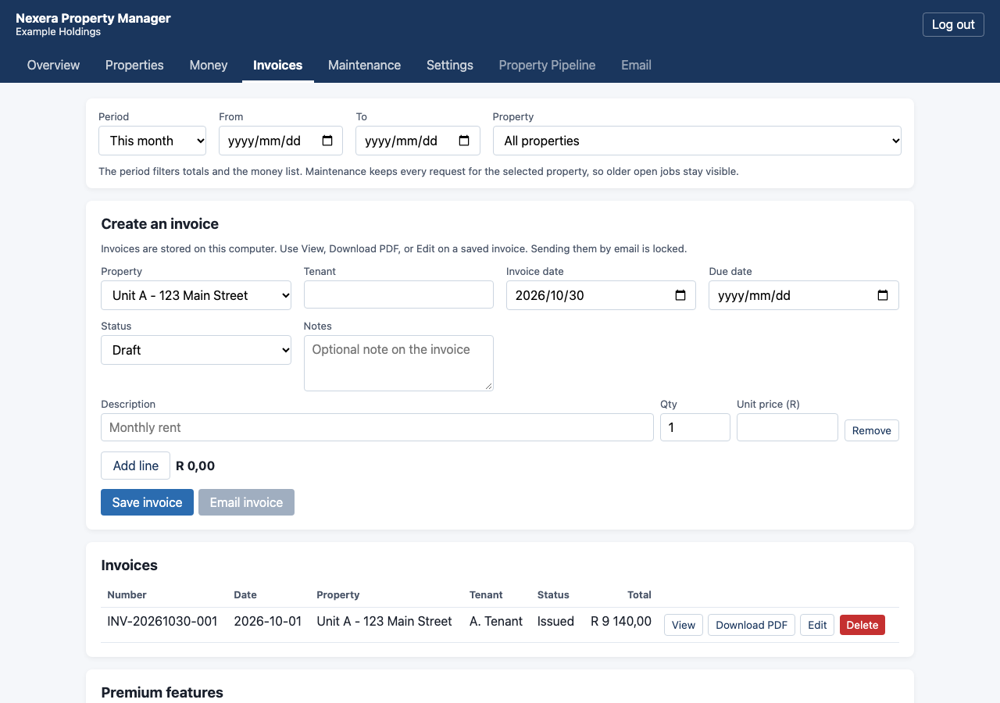
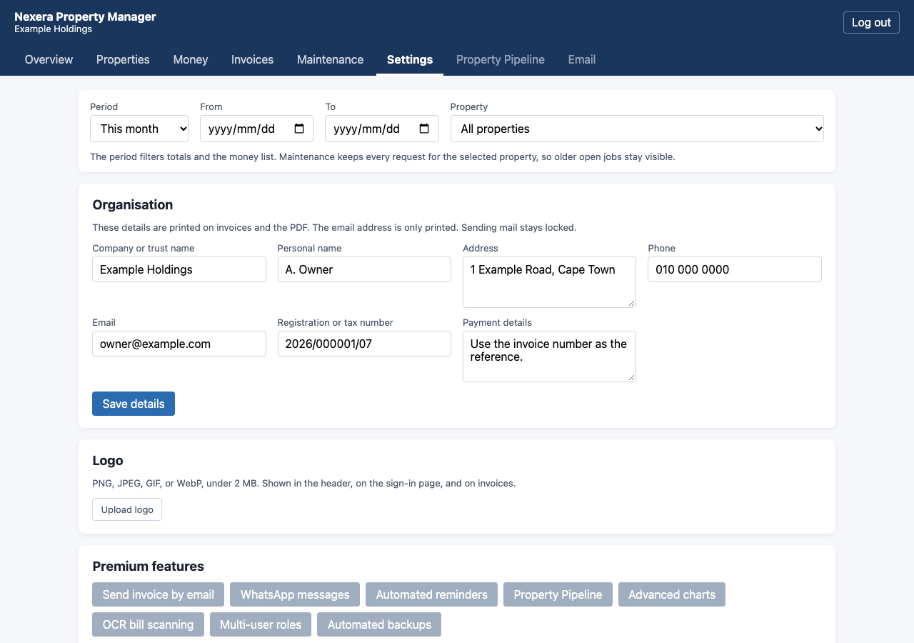

# Nexera Property Manager

Self-hosted property books for landlords and small property managers. It runs on your own computer, keeps the data in a local file, and does not need an account with us.

**[Nexera Ventures](https://www.nexerav.com)** builds this. The program in this repository is free. A hosted service, with the locked features below, is a separate product. Contact Nexera Ventures if you want that.

[](LICENSE)
[](https://github.com/nexerav/nexera-property-manager/actions/workflows/test.yml)

## Screenshots

The pictures use the sample properties that ship with a new install. They are not a real portfolio.









## What you can do

This edition is meant to be useful on its own for one person:

- Properties, including a type, expected monthly rent, notes, and a **Company Expenses** property for overhead
- Income and expenses, with dates, tenants, vendors, and categories. Recoveries have a utility list (water, sewerage, electricity, and the rest). You can type your own expense category
- Invoices: create, edit, view, print, and download a PDF. The PDF uses the name, address, and logo from Settings
- Settings for the company or trust name, personal name, address, phone, email, registration number, payment details, and logo
- A dashboard for the current month, this year, all time, or a custom range, with summary cards and one income-versus-expenses chart
- Maintenance requests, with issue type, urgency, status, an optional cost, and a button to copy that cost into expenses
- One login. Data stays in `data/rental_data.json` on your machine

## What stays locked

These appear in the app so you can see them. Choosing one shows **Premium feature – contact Nexera Ventures**. They are the parts that cost money to run, or that belong to the hosted product:

- Email sending
- WhatsApp messages
- Automated reminders
- Property Pipeline
- Advanced charts
- OCR bill scanning
- More than one user, and roles
- Automated backups
- Hosting, so you do not run it yourself

The free edition does not phone home, and it does not require a paid account to record rent, costs, invoices, or maintenance.

## Run it

You need [Docker Desktop](https://www.docker.com/products/docker-desktop/) on a Mac, or Docker Engine and Compose on Linux.

```bash
git clone https://github.com/nexerav/nexera-property-manager.git
cd nexera-property-manager
cp .env.example .env
```

Open `.env` and set `SECRET_KEY` and `APP_PASSWORD`. The app refuses to start while either value is missing, or while it is still a published placeholder. Generate a secret key with:

```bash
python3 -c "import secrets; print(secrets.token_hex(32))"
```

Put that value in `.env`, choose a password, then start:

```bash
docker compose up -d --build
```

Open [http://127.0.0.1:5000](http://127.0.0.1:5000). Sign in with `APP_USERNAME` (`admin`, unless you changed it) and the password you set.

Stop it with `docker compose down`. The `data/` folder is kept.

If a browser tab keeps spinning, close it and open the address again. If the page says the data file is busy, wait a moment and refresh. That can happen while a cloud-sync folder is updating the JSON file.

## A short tour

1. Sign in. Overview shows this month. Choose **All time** to see every record.
2. On **Properties**, add a unit or use **Company Expenses** for costs that are not tied to one unit. Deleting a property also deletes its income, expenses, invoices, and maintenance records.
3. On **Money**, add rent, a recovery, or another receipt, and add expenses. The list follows the period at the top.
4. On **Maintenance**, log a request and update its status. **Copy to expenses** adds one Repairs line when you have entered a cost.
5. On **Invoices**, add lines and save. **View** prints. **Download PDF** saves a PDF. **Email invoice** is locked.
6. On **Settings**, enter the name and address that should appear on invoices, and upload a logo (PNG, JPEG, GIF, or WebP, under 2 MB). The email field is printed on the invoice. Sending mail is locked.

A new install includes three sample properties: Unit A, Unit B, and Company Expenses. Delete them when you add your own.

## Tests

From this folder, with Python 3.9 or newer:

```bash
python3 -m pip install -r requirements.txt
python3 -m unittest tests.test_app -v
```

The tests use a temporary data file. They do not read or write `data/rental_data.json`.

GitHub Actions runs these tests and a [gitleaks](https://github.com/gitleaks/gitleaks) scan of the repository history on every push and pull request. Debug mode is off. Set `FLASK_DEBUG=1` only when you start `python app.py` yourself.

## Layout

```
.
├── app.py
├── Dockerfile
├── docker-compose.yml
├── requirements.txt
├── .env.example
├── LICENSE
├── static/            # CSS, app.js, and Chart.js
├── templates/
├── tests/test_app.py
├── docs/screenshots/
└── data/              # Created on your machine. Not part of this repository.
```

Chart.js 4.4.1 is included under `static/js/chart.umd.min.js` so the dashboard does not wait on the internet. Chart.js is MIT licensed. Copyright belongs to its authors.

## Security

This is for a computer you control. Do not publish port 5000 to the internet. The JSON file is not encrypted. Set your own `SECRET_KEY` and `APP_PASSWORD` before the first start, and keep the `data/` folder private.

See [SECURITY.md](SECURITY.md) for how to report a vulnerability. Do not include tenant names, account numbers, or a copy of your data file.

## Support

GitHub issues are welcome for bugs and for changes you can describe clearly. Nexera Ventures reads them on a best-effort basis. There is no support contract, no setup call, and no data-recovery service attached to this free edition. Please do not post private tenant or property information.

Email [support@nexerav.com](mailto:support@nexerav.com) for a question that should not be a public issue, including a security report.

For hosting, more than one user, or the locked features, use the contact details on [nexerav.com](https://www.nexerav.com).

## Contributing

See [CONTRIBUTING.md](CONTRIBUTING.md). By contributing, you agree that your contribution is licensed under the AGPL-3.0.

## Licence

Copyright (C) 2026 Nexera Ventures.

Licensed under the GNU Affero General Public License, version 3 or later. See [LICENSE](LICENSE).

You can use, change, and share this program. If you run a changed version as a service for other people over a network, the AGPL requires you to offer those users the source code of the version they are using. Contact Nexera Ventures if you need a different commercial licence.

This repository is a clean public project. It contains sample properties only.
